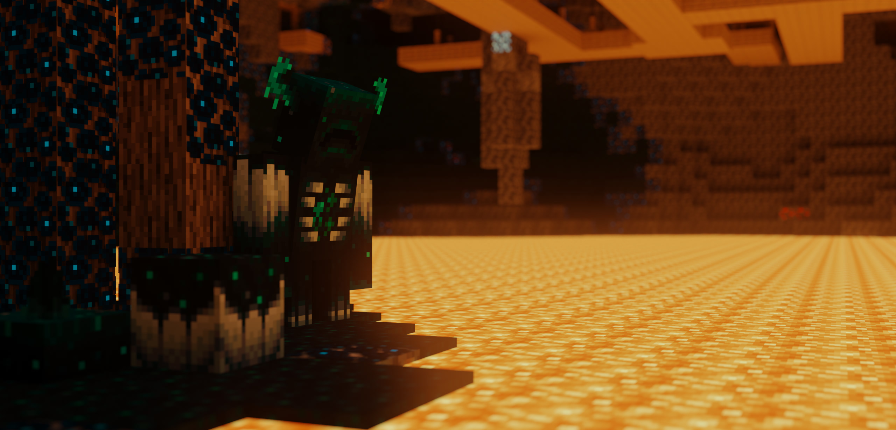
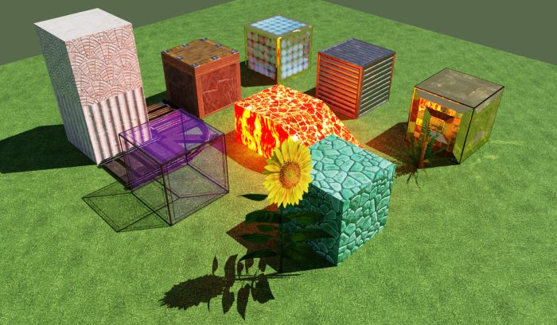

# Mineways, a Minecraft mapper and exporter
**Originally by Eric Haines, erich@acm.org — begun 11/14/2011**

> This independent fork of [erich666/Mineways](https://github.com/erich666/Mineways) adds a native macOS port and experimental mod support. The mod support preview is not an upstream release. Start with the [preview quickstart](docs/preview-quickstart.md). See the [CHANGELOG](CHANGELOG.md) for release notes.

Mineways is an open-source GUI program that exports Minecraft maps into 3D models for use in 3D software, printing and rendering. Mineways supports most Minecraft: Java Edition versions and offers many settings and functionality to customize the map export to your needs.

**Homepage is http://mineways.com which redirects to https://www.realtimerendering.com/erich/minecraft/public/mineways/**

This repository contains the source for the independent fork. Use this fork's [Releases](https://github.com/wbreiler/Mineways/releases) page for its Windows and macOS preview downloads. The homepage above describes upstream Mineways.

# Download

For experimental mod support, select the mod support preview on this fork's [Releases](https://github.com/wbreiler/Mineways/releases) page. Download the ZIP for your platform. Follow the [preview quickstart](docs/preview-quickstart.md) for the included demo. The demo does not require Python.

Use `macos-arm64` for native Apple Silicon support without Rosetta on macOS 26 or later. The separate `macos-x86_64` package supports Intel Macs on macOS 15 or later.

The older `v14.03` release predates mod support. Upstream Windows downloads also do not contain this fork's mod support. For upstream Windows releases, [visit the project homepage](https://www.realtimerendering.com/erich/minecraft/public/mineways/).

Documentation links, credits, etc are also available on the homepage.
Much of the mapping and UI code is built on the open-source project [Minutor](http://seancode.com/minutor/).

Mineways does not have a Linux build, but it runs well under [WINE](http://www.winehq.org/). See more [here for Linux](https://www.realtimerendering.com/erich/minecraft/public/mineways/downloads.html#linuxPlatformHelp). This fork provides a native macOS build; see the [Releases](https://github.com/wbreiler/Mineways/releases) page.

For upstream releases, you can also download [an older version](https://www.realtimerendering.com/erich/minecraft/public/mineways/mineways.html#versions). All upstream releases of the code back to v3.01 are [on Github](https://github.com/erich666/Mineways/releases).

# Compiling

Source files are here:

* **Win/** contains the Windows version of Mineways (in C++).
* **Mac/** contains the native macOS version of Mineways (using `wxWidgets`).
* **ChannelMixer/** contains the ChannelMixer for Mineways, which extracts the individual block textures from a mod resource pack into a directory.
* **TileMaker/** contains the TileMaker, which takes the block in that directory and forms a terrainExt.png file for use by Mineways. Using this allows you to replace any terrain textures with your own custom tiles.

## Windows
[Mineways](https://www.realtimerendering.com/erich/minecraft/public/mineways/) comes with executables, but if you prefer, you can compile Mineways with Visual Studio Community 2022:
- Install the "Desktop development with C++" workload
- Go to "Individual components", search on "MFC", and choose "C++ MFC for latest v143 build tools (x86 & x64)".
- Open Mineways.sln in Visual C++, switch the target to "Release" and "x64", then Build | Rebuild Solution.

You should then find a mineways.exe in GitHub\Mineways\x64\Release\Mineways.exe

For more on Visual Studio 2022 and C++, see [Microsoft's tutorials](https://learn.microsoft.com/en-us/cpp/get-started/?view=msvc-170).

## macOS
To compile the native macOS app:
1. Install dependencies via Homebrew: `brew install wxwidgets`
2. Run `make -C Mac app` from the project root.
3. You will find `Mineways.app` inside the `Mac/` directory. Note that the resulting app is unsigned.

For distribution-ready builds that bundle all dylibs into the `.app`, also install `dylibbundler` (`brew install dylibbundler`) — this is what the GitHub Actions CI workflow uses to produce self-contained release artifacts.

Sorry, other platforms like Linux are not directly supported, though Mineways runs fine under [WINE](http://www.winehq.org/).

If you want to work on the mapping part of this program on another platform, see [Minutor](http://seancode.com/minutor/), which *is* supported on Mac and Linux.

# License

Mineways uses the same [license](license.txt) as Minutor.

#

_Mineways and [JG-RTX](https://github.com/jasonjgardner/jg-rtx) used to make a [test scene asset](https://github.com/usd-wg/assets) for the USD file format. Rendered with [Omniverse USD Composer](https://www.nvidia.com/en-us/omniverse/apps/create/)._
